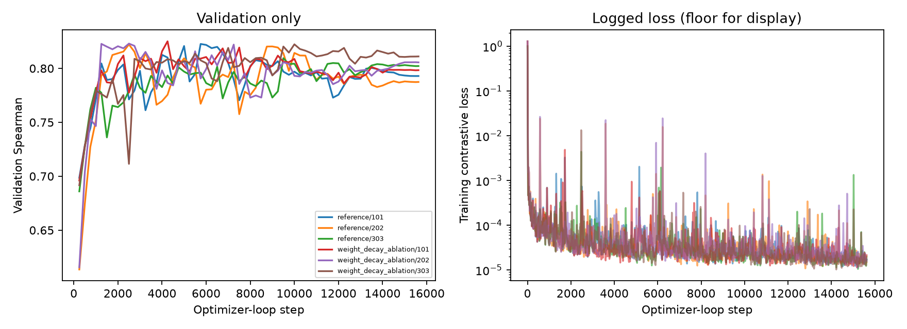

# SimCSE reproduction and optimizer ablation

DRAFT - NEEDS HUMAN VERIFICATION

## Setup

Human-selected paper: Gao, Yao, and Chen, **SimCSE: Simple Contrastive Learning of Sentence Embeddings**, EMNLP 2021. [Official proceedings](https://aclanthology.org/2021.emnlp-main.552/), [paper and appendices](https://arxiv.org/html/2104.08821v2), [official MIT-licensed code](https://github.com/princeton-nlp/SimCSE).

The target is the unsupervised BERT-base average STS Spearman result in Table 5. The author-reported single-model number is compared with our training-seed mean; these are different estimands.

All numerical evidence is indexed in [RESULTS_INDEX.md](../RESULTS_INDEX.md). The frozen protocol, source/data audits, training grid, and final-test JSON are the source of every value below.

Hyperparameters and checkpoints were chosen using validation only. No test-set tuning. All frozen seeds were retained; tests ran only after the full training grid finished.

## Results

| Configuration | Average STS Spearman (%) | Across-seed 95% CI |
| --- | ---: | --- |
| Paper, Table 5 | 76.25 | Not supplied for this headline |
| reference | 75.3388 | [73.5550, 77.1226] |
| weight_decay_ablation | 76.1695 | [75.5427, 76.7964] |

Reference minus paper: **-0.9112 percentage points**.

Weight-decay ablation minus reference: **0.8308 percentage points**, paired-seed t interval [-0.3879, 2.0495]. Negative results are retained. An interval spanning zero does not establish a directional improvement.

Intervals use Student-t over independent training-seed scores, with matched-seed differences for the ablation. They describe training variability, not uncertainty over newly sampled test examples. Few seeds limit precision.

### Per-seed and per-task results

| Config | Seed | Task | Spearman (%) |
| --- | ---: | --- | ---: |
| reference | 101 | STS12 | 66.2719 |
| reference | 101 | STS13 | 78.7740 |
| reference | 101 | STS14 | 71.5380 |
| reference | 101 | STS15 | 80.9350 |
| reference | 101 | STS16 | 77.9784 |
| reference | 101 | STSBenchmark | 76.4445 |
| reference | 101 | SICKRelatedness | 70.5893 |
| reference | 202 | STS12 | 67.6098 |
| reference | 202 | STS13 | 82.7137 |
| reference | 202 | STS14 | 73.8598 |
| reference | 202 | STS15 | 81.4551 |
| reference | 202 | STS16 | 78.4082 |
| reference | 202 | STSBenchmark | 77.1632 |
| reference | 202 | SICKRelatedness | 71.3558 |
| reference | 303 | STS12 | 67.7558 |
| reference | 303 | STS13 | 81.7788 |
| reference | 303 | STS14 | 73.1168 |
| reference | 303 | STS15 | 80.7358 |
| reference | 303 | STS16 | 77.3167 |
| reference | 303 | STSBenchmark | 75.5283 |
| reference | 303 | SICKRelatedness | 70.7855 |
| weight_decay_ablation | 101 | STS12 | 68.5543 |
| weight_decay_ablation | 101 | STS13 | 80.5816 |
| weight_decay_ablation | 101 | STS14 | 73.6297 |
| weight_decay_ablation | 101 | STS15 | 81.7012 |
| weight_decay_ablation | 101 | STS16 | 78.3904 |
| weight_decay_ablation | 101 | STSBenchmark | 77.3327 |
| weight_decay_ablation | 101 | SICKRelatedness | 71.0065 |
| weight_decay_ablation | 202 | STS12 | 69.3539 |
| weight_decay_ablation | 202 | STS13 | 82.6522 |
| weight_decay_ablation | 202 | STS14 | 74.1738 |
| weight_decay_ablation | 202 | STS15 | 81.2687 |
| weight_decay_ablation | 202 | STS16 | 78.6038 |
| weight_decay_ablation | 202 | STSBenchmark | 77.6640 |
| weight_decay_ablation | 202 | SICKRelatedness | 70.8519 |
| weight_decay_ablation | 303 | STS12 | 68.9327 |
| weight_decay_ablation | 303 | STS13 | 82.3738 |
| weight_decay_ablation | 303 | STS14 | 74.2374 |
| weight_decay_ablation | 303 | STS15 | 80.5889 |
| weight_decay_ablation | 303 | STS16 | 78.9005 |
| weight_decay_ablation | 303 | STSBenchmark | 77.2954 |
| weight_decay_ablation | 303 | SICKRelatedness | 71.4674 |

## Training and ablation

The controlled change is optimizer weight decay. Rationale and exact configurations are in [the frozen protocol](results/protocol_20261004.json). No reported weight-decay sweep was found in the inspected paper, appendices, or example; absence from reported experiments does not establish absence from unpublished trials. Human verification is required before claiming novelty.

| Config | Seed | Best validation Spearman | Steps | AMP skipped steps | Elapsed seconds | Peak allocated bytes |
| --- | ---: | ---: | ---: | ---: | ---: | ---: |
| reference | 101 | 0.822643 | 15625 | 4 | 2842.415 | 3393588736 |
| reference | 202 | 0.822199 | 15625 | 4 | 2812.034 | 3393588736 |
| reference | 303 | 0.809497 | 15625 | 4 | 2788.708 | 3393588736 |
| weight_decay_ablation | 101 | 0.825119 | 15625 | 4 | 2846.327 | 3393588736 |
| weight_decay_ablation | 202 | 0.822986 | 15625 | 4 | 2847.486 | 3393588736 |
| weight_decay_ablation | 303 | 0.822320 | 15625 | 4 | 2921.951 | 3393588736 |



## Deviations and limitations

- Modern Python/Torch/Transformers port replaces legacy dependencies; Torch AdamW is not bit-identical to legacy Hugging Face AdamW. Head/loss/gradient parity is audited on a fixture, not a complete optimizer trajectory.
- Author-hosted training corpus loses an exact normalized benchmark overlap under our audit. Document identities and semantic/near-duplicate leakage checks are unavailable.
- Dataset mirror has no license card: **UNVERIFIED**. Upstream Wikipedia terms do not establish every bundled file’s terms. Data remain local; verify original reuse and attribution before external release.
- Validation interval follows paper appendix rather than the released shell example. Final evaluation uses FP32 and a smaller inference batch; hardware/runtime/version deviations are recorded.
- Single GPU only; no DDP or concurrent-system throughput claim. Exact device and versions are recorded per run.
- Initial source/network/data parsing failures and smoke artifacts are preserved. Smoke runs are excluded from headline metrics. AMP skipped steps are disclosed above.
- Test results are final for this frozen experiment. Do not change hyperparameters to close the paper gap.

## Reproduction commands

Use the audited local source, data, and pretrained-model paths; install pinned `requirements.lock` in a suitable GPU environment. Confirm their recorded hashes before reuse.

```bash
.venv/bin/python paper_repro/run_training_grid.py
.venv/bin/python paper_repro/evaluate_reproduction.py
.venv/bin/python paper_repro/build_repro_report.py
```

Commands refuse to overwrite final artifacts. Use a fresh checkout/output location for a new experiment; complete matching checkpoints may be reused only after hash/protocol checks. No submission/publication claim is made.
